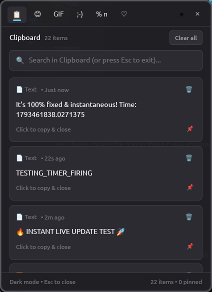
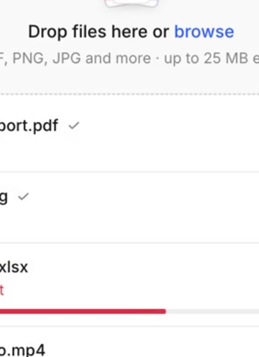

# 🚀 Nexus Panel

> **Windows 11-style Fluent Clipboard History & Emoji Picker for Linux**  
> Powered by **Rust**, **GPUI**, and native **Wayland / X11** integration.

<div align="center">

[](https://www.rust-lang.org/)
[](https://github.com/zed-industries/zed)
[](https://wayland.freedesktop.org/)
[](LICENSE)
[]()

</div>

---

## 📸 Screenshots

<div align="center">
  <table>
    <tr>
      <td align="center"><b>📋 Instant Clipboard History (<10ms)</b></td>
      <td align="center"><b>😊 Windows 11 Emoji & Kaomoji Picker</b></td>
    </tr>
    <tr>
      <td></td>
      <td></td>
    </tr>
  </table>
</div>

---

## ✨ Features

- **⚡ Instant (<10ms) Clipboard Capture**: Native Wayland streaming (`wl-paste --watch`) records text and screenshots directly into SQLite the millisecond `Ctrl+C` or a screenshot occurs — zero polling overhead!
- **🖼️ Rich Screenshot & Image Cards**: Captured images and screenshots appear with high-resolution visual previews directly inside the clipboard feed.
- **🎨 Windows 11 Fluent Design**: Acrylic translucent backdrop (90% opacity), rounded corners, smooth borders, and automatic system Dark / Light theme sync.
- **😊 Universal Emoji, Kaomoji & GIF Picker**: Full Unicode emoji support with color emoji font fallback (`Noto Color Emoji`), Japanese Kaomojis `(◕‿◕✿)`, mathematical symbols, and reaction GIFs.
- **📌 Pinning & Favorites**: Pin frequently used templates or code snippets to keep them permanently accessible.
- **🔄 Live Auto-Sync**: 150ms non-blocking foreground synchronizer keeps the open flyout updated dynamically when background items are copied.
- **🪶 Ultra-Lightweight Daemon**: Background service runs continuously under **3.4 MB RAM** with **0.00% idle CPU**.
- **🖥️ Universal Compositor Support**: First-class rules and floating window integration for **Niri**, **Hyprland**, **Sway**, **GNOME**, and **KDE**.

---

## ⌨️ Default Keyboard Shortcuts

| Shortcut | Description | Command |
| :--- | :--- | :--- |
| `Super + V` | Open Clipboard History | `nexus-ui` |
| `Super + .` | Open Emoji & Kaomoji Picker | `nexus-ui --emoji` |
| `Esc` | Close flyout window | — |

---

## 📦 Quick Installation

Run the universal installer on any Linux distribution:

```bash
git clone https://github.com/sahilcodexx/nexus.git
cd nexus
./install.sh
```

The installer will:
1. Verify system dependencies (`wl-clipboard`, `sqlite3`, emoji fonts).
2. Build the optimized release binary.
3. Install `nexus-ui` to `~/.local/bin/`.
4. Register desktop entries in `~/.local/share/applications/`.
5. Enable and start the 24/7 background systemd daemon (`nexus.service`).
6. Configure compositor window rules for Niri and Hyprland.

---

## 🏗️ Architecture & Crates

Nexus is built with a modular, high-performance multi-crate architecture:

| Crate | Purpose |
| :--- | :--- |
| [`nexus-ui`](nexus/crates/nexus-ui) | GPUI Windows 11 Fluent application and daemon supervisor |
| [`nexus-core`](nexus/crates/nexus-core) | Core domain types, clipboard entries, settings, and abstractions |
| [`nexus-storage`](nexus/crates/nexus-storage) | SQLite persistence engine with parameterized query bindings |
| [`nexus-clipboard`](nexus/crates/nexus-clipboard) | Event-driven clipboard ingestion and manager |
| [`nexus-platform`](nexus/crates/nexus-platform) | Wayland and X11 display server detection and bindings |
| [`nexus-emoji`](nexus/crates/nexus-emoji) | Searchable Unicode emoji catalog and categorization |
| [`nexus-symbols`](nexus/crates/nexus-symbols) | Currency, math, punctuation, and kaomoji dataset |
| [`nexus-gif`](nexus/crates/nexus-gif) | Curated reaction GIF provider |
| [`nexus-search`](nexus/crates/nexus-search) | Fast indexed fuzzy search engine |
| [`nexus-ipc`](nexus/crates/nexus-ipc) | Unix socket IPC messaging protocol |
| [`nexus-config`](nexus/crates/nexus-config) | User configuration management |

---

## 🛠️ Manual Build & Development

### Prerequisites
- Rust 1.80+ (`rustup default stable`)
- Vulkan development headers and drivers (`vulkan-icd-loader`, `vulkan-headers`)
- `wl-clipboard` (Wayland) or `xclip` (X11)
- `sqlite3`

### Building from Source
```bash
# Clone the repository
git clone https://github.com/sahilcodexx/nexus.git
cd nexus

# Run the build script
./build.sh

# Or build manually with Cargo
cd nexus
cargo build --release -p nexus-ui
```

### Running Tests
```bash
cd nexus
cargo test --all
```

---

## 📄 License

Distributed under the MIT License. See `LICENSE` for more information.
